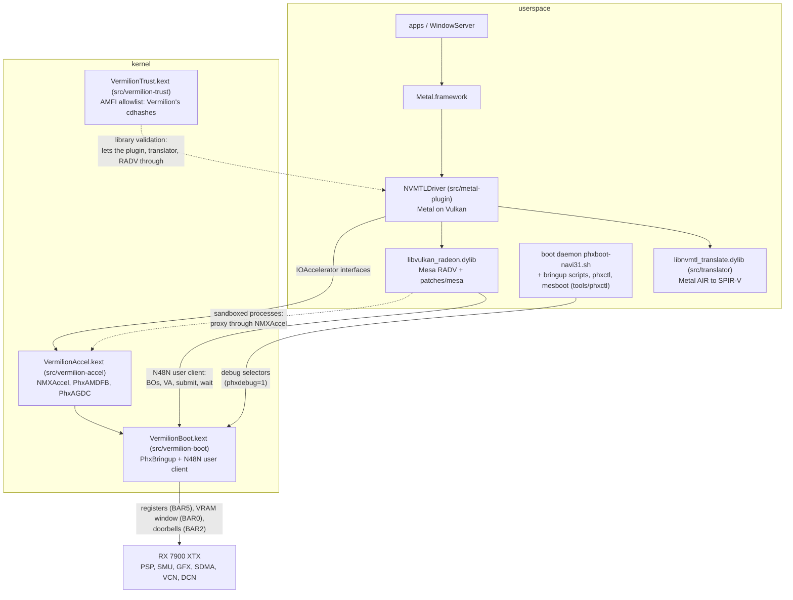

# How Vermilion works

This page explains the whole stack: what each piece does, how they talk to each other and what happens at every boot.
It is written for people and for language models that need a mental model before they read code. Terms are explained
in [GLOSSARY.md](GLOSSARY.md). File paths are relative to the repository root.

## The problem

macOS Tahoe has no driver for RDNA 3 GPUs. Apple's own AMD drivers stop at RDNA 2. So the system sees the RX 7900
as an unknown PCI device. At power-on the card's firmware (GOP) lights the monitor with a plain framebuffer, and
without a driver that's all macOS ever gets: no Metal, no GPU compositing, one fixed mode.

Vermilion fills that gap without writing a native Apple-style AMD driver. It does the following:

1. Brings the GPU up from userspace after boot. Most of that happens in shell scripts and two small C tools that
   talk to the kext; it follows the exact order Linux amdgpu uses on this card.
2. Runs **Mesa RADV**, Linux's Vulkan driver for AMD, on macOS through a small kernel interface.
3. Implements **Metal on top of Vulkan** in a plugin that WindowServer and apps load as if it were a GPU vendor's
   Metal driver.
4. Drives the display hardware (DCN) itself, mostly by keeping what the GOP set up and changing it carefully.

## The pieces



### VermilionBoot.kext (`src/vermilion-boot`)

Injected by OpenCore, so it needs no approval in macOS. It matches the PCI device `0x744c1002` and starts only on an
RX 7900 XTX: `PhxBringup::probe` and `PhxFBSquatter::probe` read the PCI revision (`PhxGpuId.h`) and return nothing for
anything but `0xC8`, before any register access ([XTX.md](XTX.md), "Supported board").

- **`PhxBringup`** (`phx_classes.cpp`, `phx_core.cpp`) maps the GPU's registers and a window into VRAM. It reads
  the VRAM size from the memory controller registers (`FB_LOCATION_BASE/TOP`) and publishes `phx-build`, the PCI
  model name and other properties.
- **`IOAccelPhxNativeClient`** is the user client, connection type `N48N`. Its ABI is in `PhxNativeABI.h` and
  follows Cobalt64's layout. RADV uses selectors 0-8 and up: hello, query info, read registers, create/free buffer
  objects, map GPU virtual addresses, contexts, submit, wait. Selectors 100 and up are **debug selectors**, open only
  with the boot-arg `phxdebug=1`. The bring-up scripts use them to read and write registers, talk to the PSP and SMU,
  and claim the GPU.
- **GPU memory** (`phx_vm.cpp`, `PhxVmTables.h`): page tables for VMID 8 in VRAM. All user buffer objects are
  system memory mapped through the GART/VM. The budgets RADV sees are fixed constants (`phx_globals.cpp`).
- **Display** (`phx_pipe0.cpp`, `phx_pipe2.cpp`, `phx_dp*.cpp`, `phx_hpd.cpp`, `Phx*.h`):
  - DCN 3.2 programming for pipe 0 (the monitor the GOP lit) and a second pipe;
  - DP link training, DPCD and AUX, HDMI SCDC, hot-plug detection;
  - the DMUB command ring and gamma.
  - Mode changes use **register plans** (`phx_p0_plan_*.inc`, `phx_s2_plan_*.inc`). They were captured from Linux
    amdgpu on the reference card, not computed (see [Display](#display)).
- **Sysctls** (`phx_sysctl.cpp`): about 200 `debug.phx*` nodes, the debugging and control surface the daemon uses.
- **`PhxFBSquatter`**: on a "squat boot" it takes the IOFramebuffer category so macOS's generic firmware-framebuffer
  driver never starts. The screen stays dark until Vermilion's own framebuffer takes over.

### VermilionAccel.kext (`src/vermilion-accel`)

Installed in `/Library/Extensions` and linked into the Auxiliary Kernel Collection. It is derived from NullMoth's
NVIDIA driver (PolyForm Noncommercial).

- **`NMXAccel`** (`accel/nvrm-accel.cpp`) is the IOAccelerator that WindowServer and Metal see as "the GPU". Its
  `Info.plist` names the Metal plugin (`MetalPluginName`, `MetalPluginClassName = NVMTLDevice`). It only matches
  after the GPU is claimed: `mesboot claim` sets the PCI property `nmxgpu-claimed` and re-runs matching.
- **`PhxAMDFB`** (`accel/phxfb.cpp`) is an IOFramebuffer, one per monitor (head). It attaches to a private
  `PhxDisplay` nub that NMXAccel publishes once Metal is live. It serves the EDID (live read, or the fallbacks in
  [EDID.md](EDID.md)), the mode list and rotation.
- **`PhxAGDC`** (`accel/phxagdc.cpp`) is Apple Graphics Device Control, used by CoreDisplay for display control.
- For sandboxed processes that may only open IOAccelerator connections (WebKit's GPU process, Chromium helpers),
  NMXAccel hands out a **proxy** of the N48N client (`patches/mesa/0014`).

### Metal plugin `NVMTLDriver` (`src/metal-plugin`)

The Metal driver bundle at `/Library/GPUBundles/NVMTLDriver.bundle`. It is derived from NullMoth's plugin and loaded by
Metal.framework in every process that uses Metal (if `/Library/GPUBundles/nvmtl-allow.txt` allows the process).

- It implements Apple's private Metal driver classes (`NVMTLDevice`, command queues, buffers, textures, pipelines)
  on Vulkan (`nvmtl_vk.c`, `NVMTLObjects.m`, `NVMTLDevice.m`).
- Shaders: a `.metallib` contains AIR, Apple's LLVM IR. The plugin hands it to `libnvmtl_translate.dylib`, which
  produces SPIR-V; RADV compiles that to RDNA 3 machine code. Results are cached in `/Library/GPUBundles/nvmtl/aircache` and
  `spvcache`.
- WindowServer present: the plugin either copies into the scanned-out surface or, with "GPU present"
  (`ws-gpu-present`), flips the display itself through the boot kext's scanout selectors (`nvmtl_scanout.c`).
- Many files are `#include`d into a few translation units (the header of each file says where). Keep that in mind
  before moving code.

### RADV (`patches/mesa`)

Mesa at commit `f5cb8ee0` with 20 patches:

- **0001-0009 (Cobalt64):** a Darwin backend that replaces the Linux DRM ioctls with the N48N user client.
- **0010-0015 (nullarc):** Phoenix APU support and the proxy path.
- **0016-0018:** a "canned" Navi 31 device profile and its shims; 0018 picks the profile by PCI revision (XTX: Mesa's
  `navi31`; `navi31_xt` is left over from upstream and no longer reached, the kexts refuse an XT).
- **0019:** the kext handshake line goes to the unified log (stderr only with `RADV_DARWIN_VERBOSE=1`).
- **0020:** a window surface for apps. Built with `-Dplatforms=macos` (`RADV_PLATFORMS=macos sh scripts/build/radv.sh`),
  RADV offers `VK_KHR_surface`, `VK_EXT_metal_surface` and swapchains through Mesa's Metal WSI (a copy to host memory
  plus a Metal blit per frame). The default build, the one the plugin loads, has no window-system platform and
  compiles to the same code as before.

RADV can't query the hardware the way it does on Linux, so the GPU's identity comes from a **canned profile**: CU
layout, cache channels, firmware versions. The memory heaps come from the kext. See [XTX.md](XTX.md) for what this
means for the XTX.

### Boot daemon and tools (`tools/phxctl`)

- **`phxboot-navi31.sh`** is a LaunchDaemon (`local.phxboot`) that runs once per boot as root. It orchestrates
  everything below and owns all the fail-safes.
- **`navi31_up.sh`** runs `bringup_navi31.sh` (PSP, firmware load, SMU, RLC, GFX power-up), then
  `mesboot`, which sets up GART, MES, KIQ and the compute and gfx queues, and hands them to the kext.
- **Optional steps**, each behind a flag file:
  - `sdma_idle.sh`, `gfx_cg.sh`, `uclk.sh`: SDMA idle, clock gating, memory clock pin;
  - `vcn_up.sh`: video engine;
  - `b15_boot.sh` and helpers: the display power recipe;
  - `m7_boot.sh`: the second monitor.
- **`phxctl`** is a CLI over the debug selectors and sysctls. **`mesboot`** is the MES and queue bring-up tool.
- The AMD firmware comes from linux-firmware at a pinned commit (`tools/firmware/fw.lock`). It is loaded by the scripts
  from `~/gpu/fw/navi31` and never stored in git.

## What happens at every boot

```mermaid
sequenceDiagram
  participant OC as OpenCore
  participant K as macOS kernel
  participant VB as VermilionBoot
  participant WS1 as WindowServer (first)
  participant D as phxboot daemon
  participant GPU
  participant VA as VermilionAccel
  participant WS2 as WindowServer (restarted)
  OC->>K: boot, inject VermilionBoot + VermilionTrust (boot-args phxdebug=1 ...)
  Note over GPU: the GOP already lit the monitor
  K->>VB: match 0x744c1002, revision C8 only, map BARs, publish phx-build
  K->>WS1: WindowServer starts on the firmware framebuffer (no Metal)
  K->>D: launchd starts local.phxboot
  D->>D: kill switch? unfinished previous attempt? then GOP only
  D->>VA: kmutil load -p if the AuxKC didn't
  D->>GPU: navi31_up.sh: PSP, SMU, RLC, GFX, GART, MES, KIQ, queues (3-min reboot watchdog)
  D->>GPU: SDMA idle, clock gating, UCLK pin (flags)
  D->>VB: mesboot claim -> nmxgpu-claimed
  VB->>VA: NMXAccel matches, Metal device appears
  D->>D: metaltest until "Metal devices: 1"
  alt desktop-arm boot (squat or phxboot-desktop)
    D->>VA: PhxAMDFB takes the panel, arm display pipe, AGDC
    D->>WS1: one killall WindowServer (nobody logged in)
    WS2->>VA: enumerates the Metal device and composites on the GPU
    D->>D: watch 120 s for crashes; 3 crashes -> revert to GOP next boot
  else no desktop arm
    Note over WS1: stays on the firmware framebuffer; apps still get Metal
  end
  D->>GPU: late steps: VCN, hot-plug, gamma, DP watcher, display power (flags)
```

The fail-safes matter as much as the bring-up ([INSTALL.md](INSTALL.md) sections 7-8):

- **Kill switch** `~/gpu/phxboot-off`: the daemon does nothing. Only the owner sets it.
- **Pending mark** `/var/db/phxboot.pending`: set from the bring-up on; if an attempt didn't finish, the next boot
  stays on the GOP (on a stuck squat: the safe desktop).
- **Revert:** any failure goes back to the firmware framebuffer (or the safe desktop) on the next boot. The record
  `/var/db/phxboot.fails` brings the full desktop back by itself after clean fallback boots. A bring-up that didn't
  finish claims nothing.
- **Watchdog:** a 3-minute reboot is armed while the PSP and SMU are being loaded.
- **Hang watch:** two WindowServer GPU hangs within five minutes mean a revert.

Two assumptions follow from this design:

- **The GPU must be cold.** The bring-up loads SMU firmware into an SMU that nothing has started yet. After another
  OS (or a VM host) has run amdgpu on the card, power off fully before booting macOS.
- **The first WindowServer runs without Metal.** Only the daemon's single restart moves it onto the GPU. Nobody may
  be logged in at that moment.

## Display

The display engine (DCN 3.2) is the most board- and monitor-specific part.

- **At boot**, the GOP trains the DisplayPort link and lights one monitor in its preferred mode. Vermilion keeps that
  mode on pipe 0. With no extra flags the desktop runs at the GOP's resolution and refresh rate.
- **Other refresh rates and the second monitor** need DCN register values for timing, clocks, watermarks, DET and
  prefetch. Linux computes them with its DML library; Vermilion doesn't contain DML. leolivm captured the values
  Linux wrote for each mode on his monitors and stored them as **plans**: lists of `(register, value, mask)` steps
  in `src/vermilion-boot/phx_*_plan_*.inc`. The engines in `PhxPipe0.h` and `PhxPipe2.h` pick a plan by the current
  OTG totals and refuse anything they don't recognise.
- So **a new monitor or resolution needs new captures.** The current plans only cover 1080p at 60/144/165 Hz. The
  steps for 1440p are in [XTX.md](XTX.md).
- **The connector table** (`PhxDdc.h boardConnectors()`) is hardcoded: DP on DIG0/DIG4/DIG1, HDMI on DIG3.
  `PhxVbios.h` can parse the same table from the VBIOS but isn't wired in yet.

## Security and system settings the stack needs

- **SIP partly off** (`csr-active-config 0x0A03`): the ad-hoc signed VermilionAccel loads from the AuxKC.
- **AMFI stays on; VermilionTrust** (`src/vermilion-trust`, injected by OpenCore after Lilu) lets only the cdhashes of
  the installed plugin, translator, LLVM, zstd and RADV through library validation in platform processes such as
  WindowServer. A new build of any of them needs a VermilionTrust and EFI rebuild
  ([runbooks](../.agents/runbooks.md#deploying-a-plugin-translator-or-radv-build-2026-11-23)). The kext's hook offsets
  were read from 25G241 only. On the XTX machine since 2026-11-22.
  - The older setup, still in the `vermilion` EFI stage and in [INSTALL.md](INSTALL.md): `amfi=0x80` with Lilu +
    AMFIPass. It turns library validation off for every process and makes every app a platform binary, which denies
    third-party privacy prompts. Whether it also breaks FairPlay 1.x (Apple Music) was never tested: on the XTX
    machine Music failed because `en0` wasn't built-in, not because of AMFI.
- **`SecureBootModel = Disabled`** in OpenCore.
- **macOS 26.7.1 exactly.** The plugin uses private Metal interfaces of that build.
- **No sleep**: sleep/wake isn't implemented (the XTX machine blocks even manual sleep: `pmset -a disablesleep 1`).

## Where the knowledge lives

| Question | Look in |
|---|---|
| What state is the XTX machine in, and what is its known-good configuration? | [PROJECT_KNOWLEDGE.md](PROJECT_KNOWLEDGE.md) |
| Where is the project going? | [ROADMAP.md](../ROADMAP.md) |
| Why is a kext build the way it is? | `src/vermilion-boot/CHANGELOG.md` (one line per build, newest first, with test results) |
| What does a script or flag do? | its header comment, then [INSTALL.md](INSTALL.md) section 7.3 |
| Why does a name start with `phx` / `nv`? | [NAMING.md](NAMING.md) |
| Who wrote what? | [CREDITS.md](../CREDITS.md), [THIRD_PARTY_NOTICES.md](../THIRD_PARTY_NOTICES.md) |
| What is different on the XTX, and what's left? | [XTX.md](XTX.md), [`.agents/TODO.md`](../.agents/TODO.md) |
